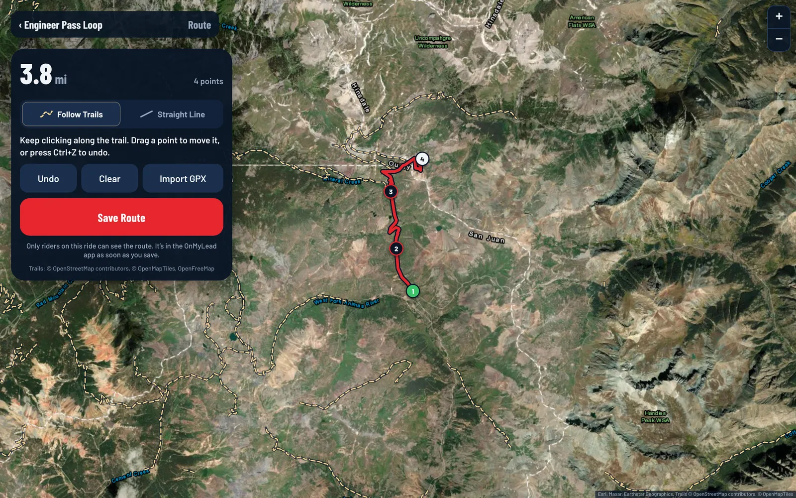

You can plan a ride on the big screen at onmylead.com. It's the same ride as one made in the app: the ride, its route and its stops show up in the OnMyLead app on your phone or tablet as soon as you save. Ride Mode and live tracking stay in the app.

:::release 2.0
Using OnMyLead on the website is a Pro feature. See [Free and Pro](/help/free-vs-pro). On a Free account, the website still lets you join a ride, open your rides and follow the leader in Ride Mode.
:::

## Create a Ride on the Web

1. Go to onmylead.com and click **Create a Ride on the Web**.
2. Sign in with your OnMyLead account if you aren't already. You go straight to Create a Ride after signing in.
3. Type a **Ride Name**, or leave it empty and the ride is named for its day, like "Saturday Ride".
4. **Day** starts on today and **Meet At** on the next quarter hour. Click **Day** and a calendar opens: type the date (such as 06/12/2027) in **Type a Date** or click it on the calendar. Click the month's name to jump to another year and month. Any day from today up to three years out works. Click **Meet At** and a list of times opens, every 15 minutes (for a ride today, only the times still to come); click one.
5. Set the **Meeting Point**. If the browser already shares your location with onmylead.com it starts as **Where You Are Now**. Otherwise, or to meet somewhere else, click **Change**: type a park, trailhead, town or address in **Search a Place or Address** (just above the map) and pick it, or click the satellite map to drop the pin, then drag the pin to fine-tune it. You can also use your location or type coordinates, and the pin moves there. Give it a **Place Name** and it shows as a one-click button under **Meeting Point** the next time you create a ride in this browser.
:::release 2.1
   From 2.1 the meeting-point map is Mapbox's satellite map, the same one the app uses, and it opens near where you are if the browser shares your location. Clicking and dragging work the same.
:::
6. Under **Who Can Join**, pick **Friends I Invite** (a private ride) or **Public**.
7. For a drawn route, click **More Options** and pick **Mapped** under **The Route**. It starts on **Freeride**. **More Options** also has the vehicles welcome, rider limits, your own invite code, riding groups and the ride's details.
8. Click **Create Private Ride** or **Create Public Ride**.

The rest of the form works the same as in the app. See [Create a Ride](/help/create-a-ride) for every option.

## Draw the Route on the Web

If you picked **Mapped**, the route builder opens after you create the ride. Click along the trail and the route follows it. Drawing a route is free. Importing a GPX file is a Pro feature. See [Build a Route](/help/route-builder) and [Free and Pro](/help/free-vs-pro).

To find a trailhead or park by name while you draw, click **Search** at the top of the map and pick a result. The map jumps there.

You can also add numbered planned stops for fuel, lunch or camp. See [Waypoints and Planned Stops](/help/waypoints-and-planned-stops).

:::release 1.0.1
The waypoints map has the same **Search**, so you can jump to a place before you click to drop a stop.
:::

:::release 2.1
## Change It Later

Open the ride on onmylead.com and click **Edit Ride Details** in the **You're Organizing** card to change the name, day, time, meeting point (click the map to move the pin) and the rest. See [Edit, Cancel or Delete a Ride](/help/edit-cancel-or-delete-a-ride).
:::

## Share It

After saving, your ride page shows the invite code, a QR code and share buttons, the same as in the app. See [Invite Riders](/help/invite-riders).

:::note
Free accounts create one ride each month, whether on the website or in the app. See [Free and Pro](/help/free-vs-pro).
:::

:::tip
When someone opens a ride link on a computer, the page shows the ride's QR code. They can scan it with their phone's camera to open the ride on their phone.
:::

:::note
Stuck while planning? Click **Help** at the top of onmylead.com to open these guides.
:::
