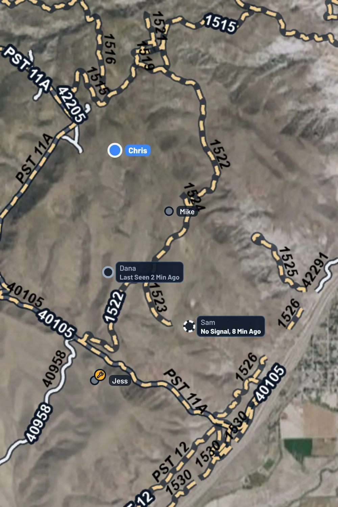

OnMyLead's maps can show public trails and roads over satellite imagery or a topo map. Tap a trail to see its name and which vehicles are allowed on it.

:::release 2.0
Satellite, topo and the trails layer are Pro features. See [Free and Pro](/help/free-vs-pro). On a Free account, **Map Style** carries a **Pro** tag and the map shows the standard map.
:::

## Open the Layers

The layers button is the round button with a stacked layers icon in the top-right corner of the map. You'll find it on:

- Ride Mode's map
- A ride's waypoints map
- The route builder
- The area picker for offline maps

:::until 2.0
Tap it to open the **Map** panel. Tap it again to close the panel.
:::

:::release 2.0
Tap it to open the **Map Style** panel. Tap it again to close the panel.
:::

:::release 2.1
The panel has **Map Style** at the top and **Map Features** under it. On a phone the panel scrolls if it's taller than the space above Ride Mode's or Map Mode's bottom panel.

In Ride Mode the leader and the ride's organizers also see **Leader Trackline** between the two, to turn the line behind the leader on or off for everyone. See [Follow the Leader's Trackline](/help/leader-trackline).
:::

Your choices are remembered on your phone and used on every map in the app.

:::release 2.1
## One Map Everywhere

From 2.1 every map in the app, on iPhone, iPad, Android and onmylead.com, is drawn by Mapbox, so a map looks and works the same wherever you open it: the same satellite photos, the same topo, the same trail lines and names, and the same pinch, turn and tap. The website's Ride Mode now has the same live map as the apps.

On a Free account the map is Mapbox's outdoors map, with roads, trails, contour lines and shaded hills. Satellite, Topo and 3D Terrain are Pro.
:::

## Satellite or Topo

At the top of the panel, pick:

:::release 2.0
Each style has a small picture of how it looks; the one you're using has a blue outline.
:::

- **Satellite**: aerial imagery with road and place labels. This is the default.
- **Topo**: the USGS topographic map, with contour lines.

:::release 2.1
- **3D Terrain**: satellite on the real shape of the land, with contour lines and peak heights. It shows in Ride Mode and Map Mode; the other maps show plain satellite while it's picked. See [3D Terrain](/help/3d-terrain).
:::

:::release 2.1
## Map Features

**Map Features** lists every kind of line and land the map can show, in three groups: **Roads**, **Trails** and **Land**. Each row has a small picture of exactly how it looks on the map, its name and a line about what it is. Tap a row to turn it on or off; a blue check means it's showing. **Show All** and **Hide All** next to a group's name turn the whole group on or off.

### Roads

- **Highways and Freeways**: interstates, freeways and major highways, a heavy solid blue line. They show from far out.
- **Paved Public Roads**: state, county and town roads, a lighter blue line, with route numbers or names when zoomed in.
- **Dirt Roads**: Forest Service, BLM and county dirt roads, a solid white line.
- **Street-Legal Only**: Forest Service roads open only to plated, highway-legal vehicles, a solid lavender line. Take an unplated UTV or dirt bike somewhere else.

### Trails

- **Off-Road Trails**: motorized trails and dirt tracks, bold amber dashes, with names.
- **Width-Limited Trails**: Forest Service trails open only to vehicles 50 inches wide or less, or only to dirt bikes, shorter orange dashes.
- **Hiking Trails**: foot and horse trails with no motor vehicles, a thinner pink dash-dot line with a light outline, so it never looks like a trail you can drive. They come from Forest Service trails closed to motor vehicles, BLM non-motorized trails and OpenStreetMap paths.
- **Closures**: red dashes. See [Closed Trails and Roads](#closed-trails-and-roads).
- **Rider Trails**: mint dots. See [Rider Trails](#rider-trails).
- **Park Trails**: the trails of offroad parks in the park's own level colors (green, blue, white, red). Free for everyone. See [Park Trails](#park-trails).

Roads, trails and closures are all on unless you turn them off. Highways, paved roads and hiking paths from OpenStreetMap are drawn on Mapbox maps (every map from 2.1); on the rare map that falls back to Apple, Google or the website's basic map, the base map shows roads in its own colors.

### Land

Land is off until you turn it on, since it tints the whole map:

- **National Forests**: Forest Service land and grasslands, tinted green with a green edge.
- **BLM Land**: Bureau of Land Management land, tinted gold.
- **National Parks**: national parks, monuments and recreation areas, tinted purple.
- **State Parks**: state parks and state recreation areas, tinted teal.
- **Property Lines**: private parcel lines in coral, in Texas for now. They show when you're zoomed in to a few blocks across. No owner names are shown.

Land shows from about a few counties across, with each area's name when you're zoomed in. Tap the map with land on to see a card with whose land it is: the area's name, who manages it, whether it's open to the public and its size. In Texas, with **Property Lines** on, tapping private land shows **Property Parcel**, its county and acres. If you tap a trail, its card comes first.

Land boundaries come from public records (USGS PAD-US and the Texas Geographic Information Office) and can be out of date. Posted signs and fences always win. Land doesn't download with an offline map yet; it shows when you have signal.

Your Map Features choices are saved and follow you to your other devices.
:::

:::until 2.1
## Public Trails and Roads

Turn **Public Trails and Roads** on to draw trail and road lines on the map. It's on unless you turn it off.
:::

:::until 1.0.1
- **Trail**: a dashed sand-colored line.
- **Road**: a solid pale line.
:::

:::release 1.0.1
- **Trail**: a bold dashed amber line.
- **Road**: a solid white line.
- **Closed**: red dashes on a dark outline. See [Closed Trails and Roads](#closed-trails-and-roads).

Every line has a dark outline, so it stands out on forest, desert and snow.

### Trail and Road Names

Zoomed in, the map shows names:

- OpenStreetMap trails get a name tag in the middle of the trail, like **Hell's Revenge 4x4 Trail**. A tag with a red border and **Closed** marks a trail mapped as closed or private. Each name follows its line's switch: Off-Road Trails names show with **Off-Road Trails**, hiking path names with **Hiking Trails**.
- Forest Service roads and trails show their name and number along the line, like **Jenny Lind 414.1**.
- Road names come from the satellite map's own labels, and the topo map has its own road names.
:::

The lines come from:

- **USDA Forest Service**: the Motor Vehicle Use Map roads and trails.
- **Bureau of Land Management**: BLM routes.

:::release 2.1
BLM moved its route map to a new address in 2026, which kept BLM lines from showing for a while. From 2.1 they show again: motorized roads in white, motorized trails as amber dashes, and trails closed to motor vehicles as pink hiking trails.

Trail lines also show up faster when you zoom in. The Forest Service and BLM draw their lines on request, so the map now asks them for far fewer, bigger pieces at a time, and close in, Mapbox draws OpenStreetMap tracks and their names itself as you pinch, instead of waiting for the map to finish loading.
:::
- **OpenStreetMap**: tracks mapped by riders, including off-road parks, state land and county roads.

:::until 1.0.2
Trail lines show once you zoom in. If you see **Zoom In to See Trails**, zoom in a little. If you see **Zoom In for Park and Local Trails**, the Forest Service and BLM lines are showing, and the OpenStreetMap tracks appear when you zoom in closer.
:::

:::release 1.0.2
Trail lines show from pretty far out. Forest Service and BLM lines appear when the map is about 60 miles across a phone screen, and OpenStreetMap tracks when it's about 15 miles across. iPad and Android tablets show them at the same zoom as a phone, over their bigger map.

- If you see **Zoom In to See Trails**, zoom in a little.
- If you see **Zoom In for Park and Local Trails**, the Forest Service and BLM lines are showing, and the OpenStreetMap tracks appear when you zoom in a bit more.
- Zoomed far out, the map draws the longest trails first and fills in short spurs as you zoom in.
- Lines already on screen stay put while you pan and zoom.
:::

:::release 1.0.3
## Rider Trails

Trails other riders mapped and shared in [Navigate](/help/navigation-mode) are drawn as **mint dotted lines**, so you can tell them apart from agency and OpenStreetMap trails. They show once you zoom in to about a county's width, when you're signed in. Tap one to see its card: it says **User Submitted Trail**, who mapped it, its difficulty, its **Quality** and **Line Accuracy** stars, and has **Rate Trail**, **Navigate** and **Details**.

Turn **Rider Trails** off in the panel (in **Map Features** from 2.1) to hide them. The same choice is on the **You** tab as **Rider Trails on Maps**. They're on unless you turn them off.
:::

:::release 2.1
## Park Trails

The trails of offroad parks (Hidden Falls Adventure Park, Katemcy Rocks, Hollister Hills and about fifty more) draw on every map as **solid lines with a dark edge**, colored by the park's own level where it rates its trails, with the park's name from far out. The **Park Trails** row in the **Trails** group of Map Features turns them off; it's free for everyone. See [Offroad Park Trails](/help/park-trails).
:::

The map on the **Find a Ride** tab shows trail lines too when you zoom in, following the choice you made here.

## See Who Can Ride a Trail

1. Make sure **Public Trails and Roads** is on (from 2.1, the trail and road rows in **Map Features**) and you're zoomed in.
2. Tap a trail or road line. In the route builder, press and hold instead, since a tap adds a route point.
3. A card shows the trail's name, where it is, whether it's a trail, road or track, the segment's miles and surface when known.

Under **Open To**, the card lists the vehicles the agency allows. If access changes by season, it says **Open To, by Season** with the open dates. If the agency data doesn't say, the card tells you.

:::release 1.0.1
If the trail or road is closed today, a red box at the top of the card says so, for example **Closed for the Season** with the date it opens again, **Closed to Motor Vehicles** or **No Public Access**. On a seasonal trail, a vehicle whose season is over shows **Closed Now** next to its dates.
:::

For an OpenStreetMap track, the card says it was mapped by riders on OpenStreetMap, and that parks and private land need permission or a pass.

:::release 2.0
## Trail Width Limits

Some trails only fit narrow machines. When the card knows a trail's width limit, it shows it under the trail's name, for example **50" Width Limit**:

- **Forest Service trails** open only to ATVs and side-by-sides 50 inches or less show **50" Width Limit**, from the Forest Service's own vehicle rules.
- **Any public trail** (Forest Service, BLM or OpenStreetMap) can show a width other riders added. The card shows the middle of everyone's entries, so one wrong number doesn't change it, and says how many riders added one.

If you added widths to your machines in the [Garage](/help/garage), the card also says whether they fit, for example **Your RZR Is Too Wide (64")** in red or **Your Grizzly Fits (48")** in green.

### Add a Width Limit

Found a gate, a posted limit or a narrow gap? Add it so other riders know before they go.

1. Tap the trail line to open its card. You need to be signed in and have signal.
2. Tap **Add Width Limit**.
3. Type the narrowest width in inches (30 to 120) and tap **Save Width**.

Your width counts once per trail. To change it, tap **Change Your Width** on the same trail. To take it back, tap **Change Your Width**, then **Remove My Width**. OnMyLead can remove a width that's far off from what other riders found.

Trails other riders mapped show the width their mapper entered. See [Map Mode](/help/navigation-mode).
:::

:::warning
Map data can be out of date. Always check posted signs and closures before you ride.
:::

:::release 1.0.1
## Closed Trails and Roads

Closed trails and roads are drawn as red dashes on a dark outline, and the panel's legend shows **Trail**, **Road** and **Closed**. A line is marked closed when:

- **Forest Service**: the road is listed as closed to motor vehicles (red, labeled **CLOSED** along the line), or a seasonal road or trail is outside its open dates for every vehicle today (red, over the trail's normal line).
- **BLM**: the route's travel plan closes it to off-highway vehicles.
- **OpenStreetMap**: the track is mapped as closed or private.

Seasonal closures show once you zoom in to about a county's width, and need a signal to load. The other closures are part of the trail lines, so they're saved with a downloaded map.

:::warning
Closures come from the agencies' published travel plans and seasons and from OpenStreetMap. They are not live gate reports: a trail can also be closed for fire, snow, repairs or a local order that isn't in this data, and coverage outside Forest Service and BLM land depends on what riders have mapped. Always check posted signs and local orders before you ride.
:::
:::

## Download a Ride's Map

On a ride with a route, the panel has **Download This Ride's Map**. One tap saves satellite, topo and trails around the route for riding with no signal. This is a Pro feature. See [Free and Pro](/help/free-vs-pro) and [Offline Maps](/help/offline-maps).

The **Offline Maps** link at the bottom of the panel opens all your downloaded maps.

## With No Signal

When your phone loses signal, a **No Signal** tag with **Downloaded Map** appears under the layers button. The map then shows only what's saved on your phone, and the satellite view switches to downloaded USGS aerial photos. See [Offline Maps](/help/offline-maps).

## On the Website

The website's route builder and waypoints map have the same layers button and map panel: **Satellite** or **Topo**, **Public Trails and Roads** (from 2.1, every **Map Features** row, including land), the trail and road names, and closed trails in red. The satellite map shows road names too. Zoomed in, the **Find a Ride** map shows the trail lines and names as well.

On the website, click a trail line to see its card when you're not adding points: on a route imported from a GPX file, for example. On the waypoints map a click adds a waypoint, so read the names on the map there. Downloading maps for no signal is only in the app.

## Map Data and Credits

- Trails and roads: USDA Forest Service MVUM and Forest Service roads, Bureau of Land Management, and map data © OpenStreetMap contributors, © OpenMapTiles, served by OpenFreeMap.
- Topo: USGS The National Map.
- Land (from 2.1): USGS PAD-US for national forests, BLM land and parks, and the Texas Geographic Information Office (StratMap land parcels) for Texas property lines.
- Hiking trails (from 2.1): USDA Forest Service trails.
- Satellite with no signal: USGS The National Map: Orthoimagery.

The credits for what's showing are listed at the bottom of the layers panel. Loading map squares only sends the area being looked at, never anything about you.
