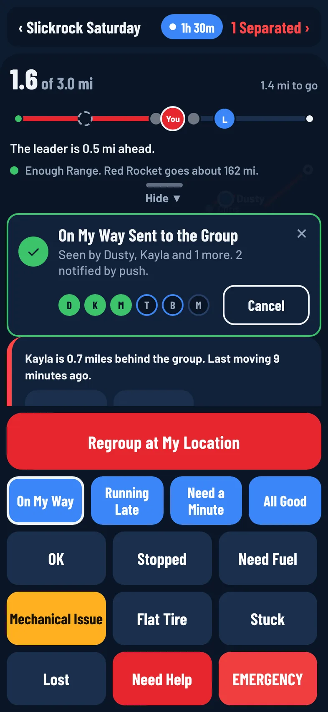

Ride Mode is the screen you use on the trail. It puts the whole group on one map, shows how fresh each rider's position is, places everyone along the route, and gives you big one-tap buttons for telling the group what's going on. Ride Mode is free on every plan.

## Open Ride Mode

Ride Mode opens once the organizer starts the ride.

- **Organizers:** on the ride page, tap **Start Ride Mode**. The ride goes live for everyone and Ride Mode opens.
- **Riders:** once the ride is live, open the ride page and tap **Enter Ride Mode**. Riders on the ride also get a notification when the ride starts.

:::release 1.0.3
The map opens centered on you, zoomed in to about 10 miles across so nearby trails show, and clear of the panels over the map. If your phone hasn't found you yet, the map centers on you as soon as it does, unless you've already moved the map yourself. If OnMyLead can't use your location, the map opens on the group, the route or the meeting point instead.
:::

The first time you open Ride Mode on a ride, it asks **Share Your Location with This Ride?** Pick how long to share, or tap **Not Now**. You can see the group without sharing, but the group can't see you. See [Share Your Location](/help/location-sharing).

:::tip
Your screen stays on while Ride Mode is open, so the map is ready when you glance at it. Keep a charger handy on long rides.
:::

## What's on the Screen

### The Top Bar

- **‹ Ride name:** tap it to go back to the ride page.
- **The sharing pill:** shows how long you have left sharing, such as **1h 20m**, or **On** when there's no timer. It says **Off** when you aren't sharing; tap it to start. While you share, tap it to show **Sharing, 1 hr 20 min left** with **Stop** and **Hide**.

:::release 1.0.1
If you've turned on [Battery Saver](/help/battery-saver), that banner also names the setting, such as **Sharing, 1 hr 20 min left · Balanced**.
:::

- **Together** or **2 Separated:** green when the group is together, red with a count when [Ride Bubble](/help/ride-bubble) sees riders who have dropped away. Tap it to open the **Riders** list.

### The Map

The map shows the ride's route, waypoints, planned stops and any regroup point. Every rider who is sharing shows as a dot with their ride name beside it. Tap a rider's dot to see their name, whether they're live, and their latest status.

:::until 1.0.3
The leader is the one bigger blue dot, so you can find them at a glance.
:::

:::release 1.0.3
Each rider is a white ring with a dark center and a dark name tag, easy to spot on satellite, topo and the dark map. The leader is the bigger solid blue dot with a blue name tag, so you can find them at a glance. Every dot sits on the rider's exact position and stays there as you zoom in and out.

When a rider is moving, a small white arrow on the edge of their dot points the way they're heading, even when you turn the map. A rider who is stopped, or whose position is only last seen, has no arrow, because a phone can only tell direction while it moves.
:::

You don't need to leave Ride Mode to see new riders. Someone who joins the ride while you're on the map appears within a few seconds of starting to share, and a rider whose share ends or who leaves the ride drops off the map within about 15 seconds.

To switch map layers or download the ride's map for riding with no signal, use the layers button on the map. See [Map Layers](/help/map-layers) and [Offline Maps](/help/offline-maps).

:::release 1.0.2
### Center the Map on You

Tap the round target button to move the map so you're in the middle of it. The map keeps how far you've zoomed in or out (if you're zoomed far out, over a whole state or more, it zooms in to about 10 miles across), and puts you in the middle of the part you can see, clear of the panel. If the app doesn't have your location yet, the button spins for a moment while your phone finds you. If location is off for OnMyLead, it offers **Open Settings** so you can turn it on.

- **iPhone and Android phones:** the button sits on the right, just above the bottom panel (above **Add Waypoint**). When the panel is open and fills the screen, fold it to see the button.
- **iPad and Android tablets:** the button sits at the bottom of the map, just left of the buttons panel.
:::

### The Bottom Panel

The panel at the bottom holds the route strip, alert cards, the quick replies and the status buttons. See [Status Buttons and Quick Replies](/help/status-buttons).

Above the panel are two buttons: **Directions** (on the left) for Apple Maps or Google Maps, and **Add Waypoint** (on the right) to mark your spot. You can also press and hold anywhere on the map to drop a waypoint there. See [Get Directions](/help/directions) and [Waypoints and Planned Stops](/help/waypoints-and-planned-stops).

On Android, **Directions** opens Google Maps, and while you share, a **Sharing Your Location** notification stays in the notification shade. Tap it to come back to OnMyLead. If your phone restarted or the app was updated while you were sharing, opening Ride Mode starts that notification and your sharing again.

## Read the Rider Dots

A dot only looks live when the phone behind it is actually checking in. A sharing phone sends its position at least every 15 seconds while it has service, even when it's parked.

| What you see | What it means |
|---|---|
| Solid dot (from version 1.0.3: a white ring, or solid blue for the leader) | Live. The position is less than a minute old. |
| Hollow dot (from version 1.0.3: a thin grey ring) with **Last Seen 2 Min Ago** | Where the rider was last seen, a minute or more ago. |
| Dashed grey ring with **No Signal, 8 Min Ago** | Nothing for three minutes or more. Their phone has likely lost service or stopped sending. |
| Faint ring, **Not Sharing** | The rider is on the ride but isn't sharing their location. |
| Yellow or red ring around a dot | Ride Bubble thinks the rider is separating from the group. |
| Amber wrench on a dot | The rider tapped **Mechanical Issue**. |
| White arrow on a dot (version 1.0.3 and later) | The rider is moving; the arrow points the way they're heading. |

## See Every Rider

Tap **Together** (or **Separated**) at the top to open the **Riders** list. It shows everyone on the ride, the leader first, with **Live**, **Last Seen** and an age, **No Signal**, or **Not Sharing**. The leader and tail gunner are labeled.

:::release 1.0.3
A small patch beside a rider's name is their top badge. See [Earn Badges and Ranks](/help/badges-and-ranks).
:::

:::release 1.0.4
A rider whose phone shares only a rough spot shows **Approximate Location**. Their dot can be a mile or more from where they are. See [Fix Common Problems](/help/troubleshooting).
:::

Tap **Navigate** next to a live rider, or **Go to Last Seen** for a rider whose spot is old, to get directions to them in your maps app.

## See Where You Are on the Route

When the ride has a route, the route strip at the bottom shows the whole route as one straight line from start to finish, with each rider placed by how far along they are. It shows your miles so far, such as **12.3 of 40.1 mi**, and how far you have to go. Below the line it tells you where you stand, for example "The leader is 0.4 miles ahead" or "2 riders ahead of you, 1 behind", and warns you if you're off the route.

If you've added your machine in the [Garage](/help/garage) with its fuel details, the strip also says whether your range covers the route. See [Fuel Range](/help/fuel-range).

:::release 1.0.3
### See the Whole Group in Order

Every rider who is sharing has a dot on the route line, strung out in running order: the rear on the left, the front on the right. Each dot sits as close to the rider's real spot as it can, and riders bunched together line up side by side instead of hiding each other, so the leader can see everyone between the front and the rear at a glance.

- **L** in blue is the leader, **S** in purple is the tail gunner, and the red **You** dot is you. Other riders show their initial.
- A hollow dot is a rider off the route. A grey dashed dot is where a rider was last seen.
- Tap a dot to see who it is and their place, such as "Mia · 3rd of 6 · 0.4 mi behind the leader".
- Riders who aren't sharing their location aren't on the line.
- With a big group, the dots get smaller to fit the line.
:::

:::release 1.0.4
### See the Group Behind the Leader on a Freeride

A Freeride has no route, so the line at the bottom of Ride Mode shows the group behind the leader instead. The leader is on the right, the rider furthest back is on the left, and everyone else is in order between them.

- The top of the line shows how spread out the group is, such as **0.9 mi spread, Leader to Tail Gunner**. When everyone is close, it says how many riders are together.
- Below the line it tells you where you stand, for example "The leader is 0.3 mi ahead". The leader sees how far back the tail gunner (or the last rider) is.
- Distances are measured along the path the leader has ridden, so bends and switchbacks count. Your phone keeps that path from the leader's live location while you're in Ride Mode; it stays on your phone and isn't uploaded.
- A hollow dot is a rider who isn't on the leader's path, such as someone who took another way or was already behind when you opened Ride Mode. Their distance is measured in a straight line.
- Until the leader shares their location, the line says it's waiting for the leader.
- Tap a dot to see who it is and their place, just like on a route.
:::

## Fold the Panel to See More Map

Swipe the bottom panel down, or tap **Hide ▼** on its handle, to fold it away. Swipe up or tap **Buttons ▲** to bring it back. The app remembers your choice.

While the panel is folded:

- **Mechanical Issue** and **EMERGENCY** stay on screen.
- Need Help and EMERGENCY calls from other riders stay on screen. The leader, tail gunner and organizers also keep Mechanical Issue calls.
- Other alerts are counted in a badge on **Buttons ▲**.

:::release 1.0.3
Sheets that slide up over the map (**Riders**, **Directions**, a waypoint, Share Your Location and **EMERGENCY**) close when you swipe them down, the same as tapping **Cancel**, **Close** or **Done**. In a long sheet, the first swipe scrolls back to the top. If the keyboard is up, the first swipe puts the keyboard away.
:::

On a tablet the map fills the screen. The **Riders** list sits on the left (tap **Hide** or swipe it left to fold it, **Show Riders** to bring it back) and the buttons panel on the right. See [Use OnMyLead on a Tablet](/help/use-onmylead-on-a-tablet).

:::release 1.0.3
## Full Map

Want the map and nothing else? Tap **⤢ Full Map** at the top of the bottom panel. The ride name, banners, map buttons and the riders list tuck away, and a slim bar at the bottom keeps:

- the route line with every rider's dot (when the ride has a route);
- **EMERGENCY**, always one tap away;
- Need Help and EMERGENCY calls from other riders;
- **Menus ▲**, with a badge counting any other alerts.

Tap **Menus ▲** to bring back the status buttons, quick replies and everything else. Full Map works the same on iPhone, iPad, Android phones and Android tablets.
:::

:::release 1.0.4
## When Your Location Isn't Sharp

If your phone's location is rough, a yellow banner says why: **Precise Location Is Off**, **Google Location Accuracy Is Off** (Android) or **Your Phone Has a Rough Location Right Now**. Tap it to fix it. On Android the phone asks to change to a precise location or to turn on Google Location Accuracy; on iPhone and iPad Settings opens; for a rough location you get steps, such as calibrating in Google Maps. The banner goes away once it's fixed. See [Make Your Location Accurate](/help/accurate-location).
:::

## When You Lose Service

If your phone can't reach the server for a short while, a banner says **No Service. Riders Show Where They Were Last Seen**. Everyone else's dots switch to last seen with their ages, because your phone can't hear new positions. If you're sharing, the banner adds that yours sends when service returns.

:::warning
Live positions only update when a phone has a connection. With an offline map downloaded, you keep the map and the route on screen with no signal, but other riders' dots don't move until your phone, and theirs, get service again.
:::

Status taps and quick replies you make with no service wait on your phone and send on their own when you get signal.

## Leave Ride Mode

Tap **‹ Ride name** at the top to go back to the ride page. Leaving the screen doesn't stop sharing: your location keeps going to the group until your timer runs out, the ride ends, you leave the ride, or you tap **Stop**.

Opened Ride Mode by tapping a notification? Tap **‹ Ride name** (or Android's Back) to go to **Home**.
