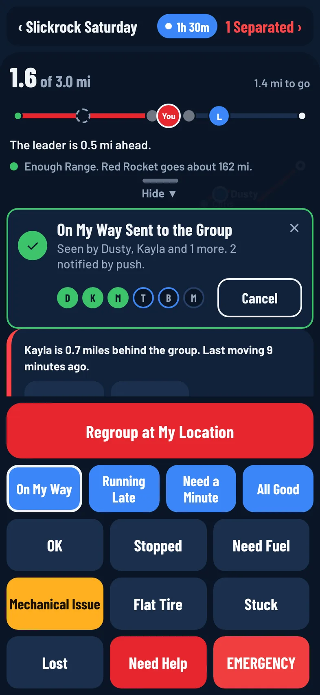
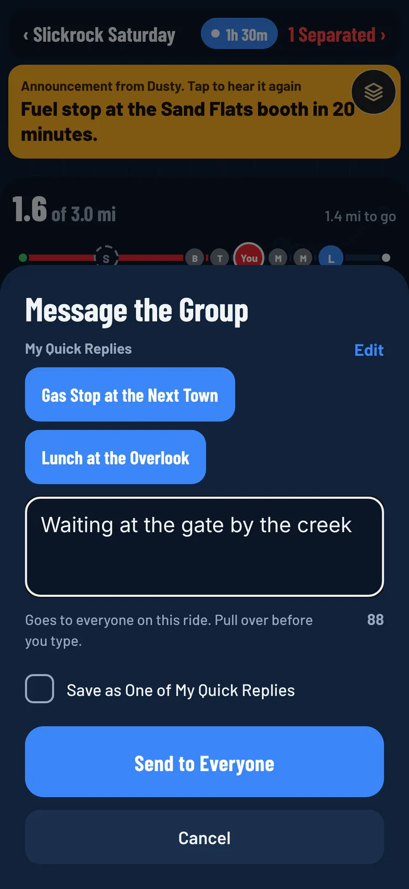

Ride Mode has big buttons so you can tell the group what's going on without typing. Every rider on the ride sees your tap, and you can see whose phone has it.

:::warning
Don't use your phone while you're moving. Pull over first, then tap.
:::

## Quick Replies

:::until 2.0
The four blue buttons send a short message to the group. They also show in the ride chat.
:::

:::release 2.0
Quick replies send a short message to the group. They also show in the ride chat. **On My Way**, **Need a Minute** and **All Good** sit on the bottom panel. Tap **More** for **Running Late**, **Beverage Break** and every status.
:::

- **On My Way**
- **Running Late**
- **Need a Minute**
- **All Good**
:::release 2.0
- **Beverage Break**
:::

:::release 2.0
## Type Your Own Message

Need to say something the buttons don't cover, like "Gas stop at the next town"? Pull over first, then:

1. Tap **Message** at the top left of the bottom panel (across from **Full Map**).
2. Type your message. It's one line of up to 120 characters, and the counter shows how many are left.
3. Tap **Send to Everyone**, or the send key on your keyboard.

It goes out just like a quick reply: the same **Sending** and **Sent to the Group** card with a light for each rider, **Cancel** to take it back, and it waits for signal if you have none. Riders get a notification titled with your name and the message, and it shows in the ride chat in italics.

To put the keyboard away without sending, tap **Done** above it on iPhone and iPad, use the back key on Android, or swipe the sheet down.

### My Quick Replies

Check **Save as One of My Quick Replies** before you send, and the message is kept on this phone or tablet. Next time, tap **Message** and tap it under **My Quick Replies** to send it in one tap. You can keep up to 6; saving a seventh drops the oldest. Tap **Edit**, then a reply, to remove it. Saved replies stay on the device you saved them on.

On a tablet the message sheet opens as a card in the middle of the screen.
:::

## Status Buttons

:::until 2.0
The grid below sets your status for the group:
:::

:::release 2.0
Tap **More** on the bottom panel to open **Tell the Group**. It has every quick reply, then your status, in two groups: **On the Move** (**OK** and **Stopped**) and **Trouble** (**Need Fuel**, **Mechanical Issue**, **Flat Tire**, **Stuck**, **Lost** and **Need Help**). **Regroup Here** (for organizers and leaders) and **EMERGENCY** are at the bottom. Tap one to send it; the sheet closes so you see the **Sending** card. Swipe the sheet down or tap **Done** to close it without sending.

The statuses:
:::

- **OK**
- **Stopped**
- **Need Fuel**
- **Mechanical Issue**
- **Flat Tire**
- **Stuck**
- **Lost**
- **Need Help**
- **EMERGENCY**

**Need Help** sends right away and shows in red for the group. **EMERGENCY** asks you to confirm first. See [Emergencies and Safety](/help/emergency-and-safety).

:::release 1.0.3
In [Full Map](/help/ride-mode), the quick replies and status buttons are tucked away and only **EMERGENCY** stays on screen.
:::

:::until 2.0
Tap **Menus ▲** to bring the rest back.
:::

:::release 2.0
Tap **Controls**, or swipe the bar up, to bring the rest back.
:::

## Send a Status

1. In Ride Mode, tap a quick reply or a status button.
2. A card appears above the buttons. It says **Sending**, then **Sent to the Group**.
3. Watch the row of lights on the card, one per rider, with their first initial:
   - A solid green light means that rider's app has it.
   - A blue ring means a notification went to their phone, but their app hasn't shown it yet.
   - An empty light means it hasn't reached them yet.

Under the headline, the card spells it out, for example "Seen by Sam and Alex. 2 notified by push." or "All 5 riders got it." Tap **✕** to hide the card. It also goes away on its own after 10 minutes.

## Take It Back

Tapped the wrong button? Tap **Cancel** on the card. The status or quick reply is taken back for everyone, the group is told to ignore it, and the notification they got is replaced with one saying you cancelled it.

## With No Signal

If your tap can't go out within a few seconds, the card says **Is Waiting for Signal**. Your tap is saved on your phone and sends by itself when you get service, stamped with the time you tapped it. Tap **Retry Now** to try again right away, or **Cancel** to drop it.

## Clear Your Status

While your status is anything other than OK, a card on your screen says **Your Status** and what you sent, with a reminder that the group sees it until you mark it resolved. Tap **Resolved, I'm OK** when you're sorted. This sends **OK** to the group.

## Mechanical Issue

**Mechanical Issue** is for a machine that has broken down.

- Your spot shows on the map with an amber wrench, even if you aren't sharing your location. It uses where you were when you tapped.
- The leader, tail gunner and organizers hear it read aloud the moment you tap it, and it stays on their screen until you send another status.
- Your screen shows **Mechanical Issue** with **Fixed, I'm OK**. Tap it once you're rolling again.

**Mechanical Issue** and **EMERGENCY** stay on screen even when you fold the bottom panel away.

## When Another Rider Taps a Status

- A card shows their name, their status and how long ago they tapped it, such as "Sam: Flat Tire, 2 min ago". Tap **Navigate** to get directions to them, or **✕** to hide it on your screen only.
- Calls drop off the list after 30 minutes. A Mechanical Issue stays until that rider sends another status.
- You get a notification on your phone. Need Help and EMERGENCY alerts are always on, even in quiet hours. Other statuses and quick replies follow your **Rider Status** setting. See [Notification Settings](/help/notification-settings).

## Regroup at My Location

:::until 2.0
Organizers, co-organizers and leaders see a **Regroup at My Location** button above the quick replies. Tap it to set a regroup point where you are.

- Everyone on the ride sees a yellow pin on the map and a yellow banner, **Regroup point set. Tap to navigate**, and hears "Regroup point set."
:::

:::release 2.0
Organizers, co-organizers and leaders see a white **Regroup Here** button at the bottom of the panel, next to **EMERGENCY** (it's also in **More**). Tap it to set a regroup point where you are.

- Everyone on the ride sees a yellow pin on the map and an amber-edged banner, **Regroup point set. Tap to navigate**, and hears "Regroup point set."
:::
- Tapping the banner opens directions to the regroup point.
- Setting a new regroup point replaces the old one.

Leaders can also tap **Regroup** on a separation alert. See [Ride Bubble](/help/ride-bubble).
