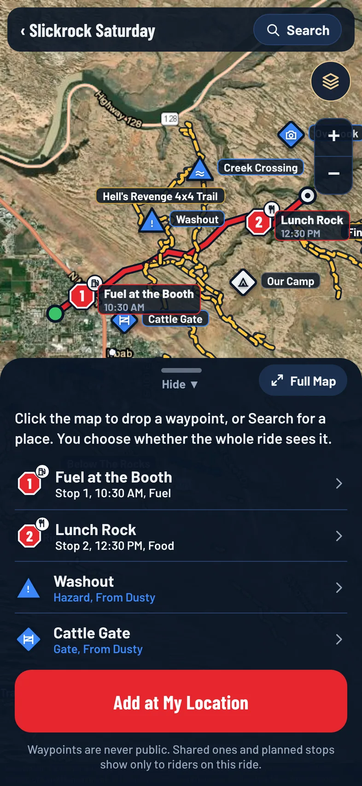

Waypoints are named spots you drop on a ride's map, such as camp, fuel, water, a viewpoint, a hazard or parking. Your own waypoints are only for you. The ride's leader can also share waypoints with everyone on the ride, and plan numbered stops the whole group will make.

Waypoints are never public. Shared ones and planned stops show only to riders on that ride.

:::release 2.0
Adding waypoints and planned stops is a Pro feature. See [Free and Pro](/help/free-vs-pro). On a Free account, **Add Waypoint**, **Add a Waypoint**, **Add a Planned Stop** and **Add at My Location** carry a **Pro** tag. Seeing the leader's waypoints and stops on a ride, and following them in Ride Mode, stay free.
:::

## Who Sees What

- **Your waypoints**: only you see them, unless you can share (below).
- **Shared waypoints**: the leader or an organizer can share a waypoint with everyone on the ride.
- **Planned stops**: always shared. Every rider sees them numbered on the map, in order.

The leader is the rider with the Leader role, or the organizer when nobody has it. See [Leader, Sweep and Tail Gunner](/help/leader-sweep-and-tail-gunner).

You need to have joined the ride to add or see its waypoints.

## Add a Waypoint

1. Open the ride and tap the **Map** tab.
2. Under **Waypoints**, tap **Add a Waypoint** (or **Open Waypoints Map** if there are some already).
3. Press and hold the map where you want it (click it on onmylead.com). To mark where you're standing, tap **Add at My Location** instead.
:::until 2.0
4. Pick what it is: **Spot**, **Camp**, **Fuel**, **Water**, **Viewpoint**, **Hazard** or **Parking**. The name fills in for you.
:::
:::release 2.0
4. Pick its symbol. The name fills in for you. See [Waypoint Symbols](#waypoint-symbols) below.
:::
5. Change the **Name** if you like, and add a **Note (Optional)**.
6. If you're the leader or an organizer, choose who it's for under **What It Is** (see below).
7. Tap **Save Waypoint**.

:::release 1.0.3
Changed your mind? Swipe the sheet down, or tap **Cancel**, to close it without saving.
:::

:::release 1.0.1
To find a spot by name, tap **Search** at the top of the waypoints map and type a park, trailhead, town or address, such as "Hidden Falls Adventure Park". Pick a result and the map moves there and labels it. Then press and hold (or click) the map at that spot to drop the waypoint. Search only moves the map; nothing is added until you drop it. See [Search for a Place](/help/place-search).
:::

In Ride Mode, tap **Add Waypoint** to drop one where you are, or press and hold the map. See [Ride Mode](/help/ride-mode).

:::release 2.1
## Press and Hold the Map

In Ride Mode and Map Mode, press and hold anywhere on the map. The **New Waypoint** sheet opens for that spot: pick a symbol, change the name if you like, add a note and tap **Save Waypoint**. On onmylead.com, right-click the map in Map Mode instead (or press and hold on a touch screen).

- **On a group ride** (Ride Mode, or Map Mode while you're sharing your location with a live ride): the waypoint goes on that ride. If you're the leader or an organizer it starts as **Everyone on the Ride**, so the whole group sees it. Other riders' waypoints are just for them.
- **In Map Mode on your own**: the waypoint is yours and saved on your phone, so it works with no signal. With [Sync Across Devices](/help/sync-across-devices) (Pro) it also shows on your other devices.

While the **Draw** tab is open in Map Mode, taps add points to the line, so press and hold doesn't drop waypoints until you switch tabs.

To change one later, tap it on the map, then tap **Edit** (name, symbol, note) or **Remove**.

## New Waypoint Alerts

When the leader or an organizer shares a waypoint or a planned stop while the ride is live, everyone else on the ride gets a notification with a sound, like "Lou added a new waypoint: Fuel Stop". Tap it to open Ride Mode with that waypoint showing. It also goes into your [Notifications](/help/notifications-inbox).

- It goes out once per waypoint: when it's added for everyone, or when a **Just Me** waypoint is switched to **Everyone on the Ride**. Editing it afterwards, or switching it to **Just Me** and back, doesn't send another.
- Waypoints set up before the ride starts don't send alerts. They're on the map when riders open Ride Mode.
- New waypoint alerts follow the **Announcements** switch in [Notification Settings](/help/notification-settings) and your quiet hours.
:::

Names can be up to 60 characters and notes up to 280.

:::release 2.0
## Waypoint Symbols

Every waypoint has a symbol, so you can tell what it is at a glance on the map. There are 15:

| Symbol | Use it for |
| --- | --- |
| **Spot** | Anything else |
| **Camp** | A campsite or where you'll stay the night |
| **Fuel** | A gas station or fuel cache |
| **Water** | Drinking water or a refill |
| **Food** | Lunch, a restaurant or a snack stop |
| **Viewpoint** | A scenic overlook |
| **Photo Spot** | A good place for group photos |
| **Hazard** | A washout, drop-off or anything to watch for |
| **Water Crossing** | A creek or river crossing |
| **Gate** | A gate to open and close behind the group |
| **Trailhead** | Where a trail starts |
| **Parking** | Trailer or vehicle parking |
| **Restroom** | A toilet or outhouse |
| **First Aid** | A first aid kit, clinic or help point |
| **Repair** | A shop, or a good place to work on a vehicle |

Each symbol has its own drawing, so they're easy to tell apart without relying on color, including for color-blind riders. **Hazard** and **Water Crossing** sit on a triangle instead of a diamond, so warnings stand out by shape. Shared waypoints are blue and your own are white.

A planned stop shows its symbol on a small white tag at the corner of its numbered stop sign, so everyone sees whether the stop is for fuel, food or camp.

To change a symbol, tap the waypoint, tap **Edit**, and pick another one.

The symbols show on the phone, the tablet and onmylead.com. Riders who haven't updated the app yet see the newer symbols as the closest older one (a **Gate** shows as a **Spot**, a **Water Crossing** as a **Hazard**) until they update.
:::

### Sharing a Waypoint (Leader and Organizers)

When the leader or an organizer adds a waypoint, they choose:

- **Planned Stop**: the whole ride stops here. Numbered on every rider's map.
- **Everyone on the Ride**: shows on every rider's map.
- **Just Me**: only you see it.

New waypoints from the leader or an organizer start as **Everyone on the Ride**, and you can switch to **Just Me**.

## Plan the Ride's Stops

Planned stops tell everyone where the group will stop for fuel, lunch or camp, and in what order.

1. Open the ride and tap the **Map** tab.
2. Under **Planned Stops**, tap **Add a Planned Stop**.
3. Press and hold the map where the group will stop.
4. Pick what it is and give it a name.
:::until 1.0.3
5. Add a **Planned Time (Optional)**, like "12:30 pm".
:::
:::release 1.0.3
5. To add a **Planned Time (Optional)**, tap **Add**, then tap **AM** or **PM**, the hour and the minute. It starts at 12:00 PM. Tap **Clear** to remove it.
:::
6. Tap **Save Planned Stop**.

Stops are numbered in the order you add them. To change the order:

1. Tap a planned stop on the map or in the list.
2. Tap **Move Earlier** or **Move Later**.

The leader or an organizer can edit any planned stop on the ride, even ones someone else added, so the plan carries on if the leader changes.

## View, Navigate, Edit or Remove

Tap a waypoint on the map or in the list to open it. You'll see its symbol, who it's from, the note and its coordinates.

- **Navigate**: get directions in your maps app. See [Directions](/help/directions).
- **Edit**: change it. You can edit your own waypoints. The leader or an organizer can also edit planned stops.
- **Remove**: take it off the map. You can remove your own. The leader or an organizer can also remove shared ones. When a shared waypoint is removed, everyone stops seeing it.

## On the Website

The waypoints map works on onmylead.com too. Click the map to drop a waypoint, and click a waypoint to open it.

:::release 2.1
From 2.1 the waypoints map is drawn by Mapbox on every device, so it looks the same on the phone and the website, and Ride Mode on the website has a live map where you can press and hold too. On the website, right-click a trail line to see its card. If the Mapbox map isn't available there, Ride Mode on the website shows the route sketch instead, so add ride waypoints from the ride's waypoints map.
:::

On a tablet held sideways, the waypoint list sits beside the map; swipe it up or tap **Hide** to fold it.

:::release 2.0
For the whole screen, tap **Full Map** on the panel's grab bar. Press and hold the map to drop waypoints as usual, and tap **Controls** (or swipe the bar up) to bring the list back. See [Full Map](/help/full-map).
:::

## No Signal

The waypoints you can see are saved on your phone, so they stay on the map without signal. The panel shows **Saved on This Phone** when that's what you're seeing.

## Limits

Each rider can add up to 100 waypoints on a ride. If you reach that, remove one to add another.

:::release 2.1
In Map Mode you can keep up to 2,000 waypoints of your own.
:::

:::note
Waypoints are different from the numbered points you tap when drawing a route. Route points shape the line; waypoints mark places along the way.
:::
